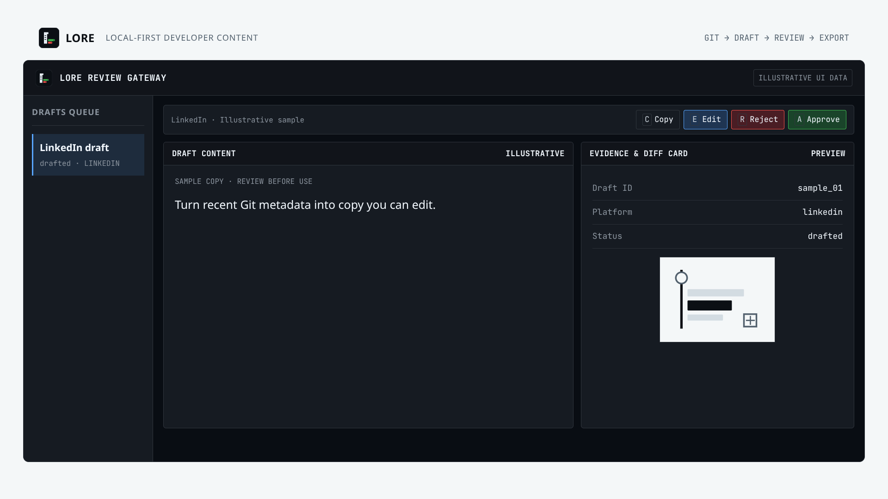
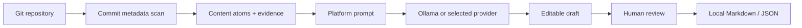

# Lore

<p></p>

**Turn recent Git history into a draft you can edit and export.**

Lore is a local-first Python CLI for developers who want a starting point for sharing engineering work. It reads Git commit metadata, groups related changes into content atoms, generates platform-shaped drafts with a model you choose, and keeps review and export on your machine.

<p>
  <a href="https://python.org"></a>
  <a href="BETA.md"></a>
  <a href="LICENSE"></a>
</p>

<p align="center">
  
</p>
<p align="center"><em>Illustrative dashboard preview. Draft text and record values shown here are sample data.</em></p>

> **Beta:** Lore is installed from its GitHub source; the package is not published to PyPI. Read the [beta guide](BETA.md) before trying it with a repository.

[Quickstart](#quickstart) · [Commands](#command-reference) · [Architecture](#architecture) · [Privacy](#privacy-and-data-handling) · [Development](#development)

## Contents

- [What Lore does](#what-lore-does)
- [Tech stack](#tech-stack)
- [Quickstart](#quickstart)
- [Command reference](#command-reference)
- [Configuration](#configuration)
- [Architecture](#architecture)
- [Privacy and data handling](#privacy-and-data-handling)
- [Limits and beta status](#limits-and-beta-status)
- [Development](#development)
- [Feedback](#feedback)
- [License](#license)

## What Lore does

Lore turns recent repository activity into editable drafts for engineering updates. It supports short posts, threads, LinkedIn posts, blog drafts, and changelogs. You inspect the draft and its Git evidence, then decide whether to edit, approve, reject, or export it.

| Step | What Lore does |
| --- | --- |
| Scan | Reads commit metadata for a selected time range: subjects, dates, authors, changed paths, and insertion/deletion counts. |
| Group | Groups related commits into content atoms and records the commit SHAs and metadata used as evidence. |
| Draft | Sends a platform prompt to your configured model and saves the returned text as a draft. |
| Review | Lets you inspect and edit drafts in the terminal or the local web dashboard. |
| Export | Writes selected drafts to local Markdown or JSON files. |

The scan-to-draft path does not read source files or patch contents. The evidence points back to Git records; it does not confirm every sentence in a generated draft.

Optional image generation creates an editable SVG illustration from a saved draft and its evidence summary. PNG output is available when a local rasterizer is installed. Lore does not publish the draft or image from the CLI.

### Data flow



## Tech stack

| Area | Technology |
| --- | --- |
| Runtime | Python 3.12 or newer |
| CLI and terminal UI | Click and Rich |
| Data models and storage | Pydantic and SQLite |
| Prompts and provider requests | Jinja2 and httpx |
| Configuration | YAML |
| Local review dashboard | Python standard-library HTTP server |

## Quickstart

### Requirements

- Python 3.12 or newer
- Git
- Ollama running locally, or credentials for a supported remote model provider

### Install Lore for use across repositories

Install [pipx](https://pipx.pypa.io/) first, then install Lore from the GitHub repository:

```bash
pipx install "git+https://github.com/Sumeet-basfore/lore.git@main"
pipx ensurepath
```

Open a new terminal if `lore` is not on your `PATH`. These commands work in macOS, Linux, and PowerShell. To refresh this source install after an update:

```bash
pipx install --force "git+https://github.com/Sumeet-basfore/lore.git@main"
```

Check the CLI and configure your model once:

```bash
lore --help
lore init
```

The default provider is Ollama at `http://localhost:11434`. `lore init` asks for your provider, model, name, and social handle. For remote providers, configure the appropriate API key in your shell environment; see [Configuration](#configuration).

### Scan and draft from another project

Change to the Git repository you want to use. On first use, Lore asks before registering an unregistered repository. If you need a non-interactive setup, register it explicitly from its root:

```bash
cd /path/to/your/repository
lore project add . --name my-project
```

Then scan, generate, and review:

```bash
lore scan --since "14 days ago"
lore atoms
lore generate --platform linkedin
lore draft show <draft-id>
lore review
```

`lore generate` prints the draft ID. Replace `<draft-id>` with that value. You can pass `--atom <atom-id>` to draft from a specific atom. The default platform is `twitter`.

The terminal review screen supports approve, reject, edit, previous/next, and quit actions. To open the local web dashboard instead:

```bash
lore review --web
```

After approving a draft, export it locally:

```bash
lore export --status approved --format markdown --output-dir ./exports
```

### Generate an illustration

Generate an editable SVG for a saved draft:

```bash
lore image generate <draft-id>
```

Lore writes the SVG to the project’s `lore-media/` directory by default and links it to the draft for local preview. To also create a PNG:

```bash
lore image generate <draft-id> --format png
```

PNG conversion needs a local renderer. The SVG source is retained. Use `--force` if you want Lore to replace an existing image file.

## Command reference

Use `lore --help` or `lore <command> --help` for current options.

| Command | Purpose |
| --- | --- |
| `lore` | Show the current repository context and suggested next commands. |
| `lore init` | Configure the default provider, model, author name, and handle. |
| `lore project add <path> --name <name>` | Register a repository. `--description` is optional. |
| `lore project list` / `lore project remove <name>` | List or remove a registered project. |
| `lore scan --since <range>` | Scan Git history; defaults to the last 14 days. Use `--project <name>` or `--all` to select scope. |
| `lore atoms` | List extracted content atoms. Supports `--project` and `--status` filters. |
| `lore generate --platform <format>` | Generate a draft. Formats: `twitter`, `thread`, `linkedin`, `blog`, `changelog`. |
| `lore drafts` | List drafts. Supports project, platform, and status filters. |
| `lore draft show <id>` | Inspect a draft and its evidence. |
| `lore draft edit <id>` | Edit draft content with the configured terminal editor. |
| `lore draft approve <id>` / `lore draft reject <id>` | Change the review status of one draft. |
| `lore review` | Review pending drafts in the terminal. |
| `lore review --web [--port 4748]` | Open the dashboard on loopback. The dashboard uses a fallback port if the requested port is busy. |
| `lore export` | Export drafts to Markdown or JSON. By default it exports approved drafts to `./exports`. |
| `lore image generate <id>` | Generate an editable SVG illustration; optionally also render a PNG. |
| `lore card` | Create a local SVG or PNG card from a Git diff or a supplied diff file. |
| `lore voice add <file>` / `lore voice list` | Store writing samples locally and manage them. |
| `lore calendar` | Show suggested content slots based on scanned atoms; it does not schedule posts. |
| `lore config list` / `lore config set <key> <value>` | View or update local configuration. |
| `lore mcp` | Start Lore’s stdio MCP server for a compatible client. |

`lore card` is a separate local rendering command. Without `--diff`, it renders the diff from `HEAD~1` to `HEAD`; with `--diff`, it reads the supplied file. That input is outside the scan-to-draft flow described above.

## Configuration

### Local files

By default, Lore stores its configuration and database under `~/.lore/`:

| Path | Contents |
| --- | --- |
| `~/.lore/config.yml` | Provider, model, author details, and other CLI settings. |
| `~/.lore/lore.db` | Registered projects, atoms, drafts, and voice samples. |

Set `LORE_HOME` before running Lore to use a different data directory. For example, to keep beta data separate on macOS or Linux:

```bash
export LORE_HOME="$HOME/.lore-beta"
```

On PowerShell:

```powershell
$env:LORE_HOME = "$HOME\.lore-beta"
```

Use `lore init` for first-time setup. `lore config list` displays the current settings with sensitive values redacted. A key saved in `config.yml` is stored without encryption; environment variables are preferable for API keys. Do not pass real keys as command-line values, where shell history may retain them.

### Providers and environment variables

Ollama at `http://localhost:11434` is the default. Lore also supports OpenAI, Anthropic, OpenRouter, Gemini, and a separately configured Ollama endpoint.

| Variable | Used by |
| --- | --- |
| `OPENAI_API_KEY` | OpenAI |
| `ANTHROPIC_API_KEY` | Anthropic |
| `OPENROUTER_API_KEY` | OpenRouter |
| `GEMINI_API_KEY` or `GOOGLE_AI_API_KEY` | Gemini |
| `EDITOR` | Terminal draft editing; defaults to `nano` if unset. |
| `LORE_HOME` | Override the local Lore data directory. |
| `LORE_MOCK_LLM=1` | Test mode that returns canned sample text. Do not use this output as project content. |

For Windows PowerShell, set Notepad as the editor if needed:

```powershell
$env:EDITOR = "notepad"
```

When you select a remote provider or remote Ollama endpoint, Lore sends the prompts described in [Privacy and data handling](#privacy-and-data-handling) to that endpoint.

## Architecture

Lore is a local CLI. The core workflow runs in the calling user's checkout and stores its records in a local SQLite database.

```text
Git repository
  └─ Git metadata scan
       └─ Content atoms + evidence
            └─ Prompt template + style guidance
                 └─ Local Ollama or selected remote model
                      └─ Local draft database
                           └─ Human review
                                └─ Markdown / JSON export
```

| Area | Responsibility |
| --- | --- |
| `src/lore/cli.py` | Click commands and terminal workflow. |
| `src/lore/scanner/` | Git history and local project metadata inspection. |
| `src/lore/extraction/` | Content atom grouping and evidence records. |
| `src/lore/intelligence/` | Story-angle ranking and calendar suggestions. |
| `src/lore/generation/` | Provider routing, platform prompt templates, and text cleanup. |
| `src/lore/visual/` | Diff cards and draft-linked SVG illustrations. |
| `src/lore/approval/` | Terminal review and the loopback web dashboard. |
| `src/lore/core/` | Pydantic models, SQLite storage, and domain exceptions. |
| `src/lore/mcp/` | Stdio Model Context Protocol server. |
| `src/lore/publishing/` | Provider adapters exist in the source tree; publishing is not exposed as a CLI command. |
| `tests/` | Pytest unit and integration tests. |

The dashboard is a small local HTTP server that binds to `127.0.0.1`. Lore has no hosted backend or deployment configuration.

## Privacy and data handling

Lore keeps project records and drafts on your computer, but generation sends a prompt to whichever model endpoint you have selected.

| Action | Data read or sent |
| --- | --- |
| Register a project | Locally checks the repository path, README introduction, and selected project metadata files to infer a name and technology stack. |
| Scan Git history | Reads commit subjects, author details, timestamps, changed paths, insertion/deletion counts, and commit SHAs. The normal scan-to-draft flow does not read patch contents. |
| Generate text | Sends the project name, selected atom and commit summaries, evidence fields, technology stack, and style guidance to the configured model. Changelog prompts can include commit subjects. |
| Add a voice sample | Stores the sample locally. Lore derives brief style guidance for prompts; it does not add the full sample text to the generation prompt. |
| Generate an illustration | Sends the project name, platform, draft title and excerpt, linked atom title/summary, and evidence counts to the configured model. It does not send source files or patch contents. SVG markup is rendered locally from a restricted scene schema. |
| Render a diff card | Reads a local Git diff or supplied diff file and renders the card locally. This is separate from scan-to-draft generation. |

With the default Ollama URL, generation requests go to the local Ollama endpoint. A remote model provider or remote Ollama URL receives its prompt under that provider’s terms.

Lore stores its SQLite database and YAML configuration locally without encryption. The separate DLP scanner in the source tree is not connected to the normal scan-to-draft path and should not be treated as protection for prompts.

## Limits and beta status

- Generated drafts and illustrations can be wrong or misleading. Evidence links records to Git metadata; it does not verify each sentence, establish impact, or prove that a change improved performance.
- The scan-to-draft workflow reads metadata rather than source patches. Vague commit messages can leave out the reason for a change.
- Some secret-like filenames are filtered, but this is not complete secret detection. The standalone DLP module is not active in the normal CLI flow.
- Lore does not publish posts or images from the CLI. Review and export are the end of the supported workflow.
- Invalid image-scene output can fall back to Lore’s built-in Evidence Strata motif, which may not be tailored to the draft.
- The package is not published to PyPI. Install the beta from source with pipx or install the checkout directly.
- `LORE_MOCK_LLM=1` is for testing only and returns canned content, not a draft based on your repository.

Before approving or sharing an export, check its claims against the underlying work. For provider data and image prompts, review [Privacy and data handling](#privacy-and-data-handling) and the [beta guide](BETA.md).

## Development

### Set up a checkout

Install Git and Python 3.12 or newer, then clone and install the project with its development dependencies.

macOS or Linux:

```bash
git clone https://github.com/Sumeet-basfore/lore.git
cd lore
python3.12 -m venv .venv
source .venv/bin/activate
python -m pip install -e ".[dev]"
```

Windows PowerShell:

```powershell
git clone https://github.com/Sumeet-basfore/lore.git
cd lore
py -3 -m venv .venv
& .venv\Scripts\python.exe -m pip install -e ".[dev]"
```

### Run the test suite

```bash
python -m pytest
```

If you are manually trying commands against test data, set `LORE_HOME` to a separate directory first.

### Project map

```text
src/lore/
├── cli.py                  # CLI entry point and commands
├── config.py               # Local configuration paths and loading
├── core/                   # SQLite database, models, exceptions
├── scanner/                # Git scanning and project inspection
├── extraction/              # Content atoms and evidence records
├── intelligence/           # Narrative angles and calendar suggestions
├── generation/              # Provider router, prompts, humanizer
├── visual/                  # SVG illustration and diff-card rendering
├── approval/                # Terminal review and local dashboard
├── mcp/                    # MCP stdio server
└── publishing/              # Provider adapters; not exposed as CLI publishing
```

This repository is a local-first CLI rather than a hosted application. There is no Docker, cloud, or server deployment setup to configure.

## Feedback

Report bugs or beta feedback in [GitHub Issues](https://github.com/Sumeet-basfore/lore/issues). Include the Lore and Python versions, the command you ran, what you expected, and a sanitized error message. Do not attach API keys, private diffs, customer information, or other sensitive repository data.

## License

Lore is released under the MIT License. See [LICENSE](LICENSE).
